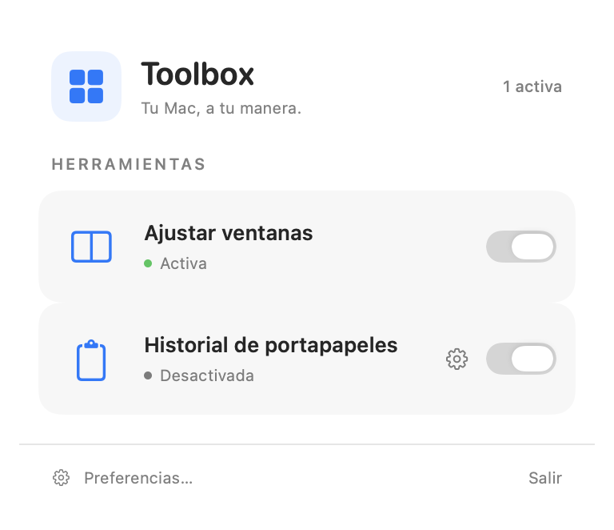

# Toolbox para macOS

[Read in English](README.md)

Toolbox es una app nativa que pone dos herramientas cotidianas en la barra de menús: ajuste de ventanas e historial de portapapeles con buscador. Es un [side project de Gatsbysland](https://gatsbysland.com/es#quests) hecho con Swift, SwiftUI y AppKit.



## Qué puedes hacer

- **Ajustar ventanas.** Arrastra una ventana al borde izquierdo o derecho para ocupar media pantalla, o al superior para llenar el escritorio disponible. Suelta cuando aparezca la previsualización. Puedes configurar la separación entre ventanas y recuperar el tamaño anterior al arrastrarlas fuera del borde.
- **Recuperar algo que copiaste.** Abre el historial con **⇧⌘V** (o graba tu propio atajo) para buscar texto, texto con formato, enlaces, imágenes, PDF y referencias a archivos del Finder. Selecciona una entrada y pulsa Intro o haz clic para devolverla al portapapeles. Pega después con **⌘V**. Toolbox puede reproducir un sonido breve al capturar o volver a copiar una entrada.
- **Pegar en la app anterior.** Activa **Pegar al seleccionar** en las preferencias del historial para pegar una entrada donde estabas trabajando. Esta opción viene desactivada. El menú contextual siempre ofrece **Volver a copiar** para copiar sin pegar.

El icono de cuatro cuadrados de la barra de menús abre el cajón. Desde ahí puedes activar o desactivar cada herramienta y abrir sus preferencias.

## Compilar y arrancar

Necesitas un **Mac con Apple Silicon y macOS 26 o posterior**, y **Xcode 26 o posterior** con Swift 6.2 y el SDK de macOS 26. La primera publicación incluye el código fuente. El instalable queda para una versión posterior.

Clona el repositorio y elige un certificado **Apple Development** válido con su clave privada en el llavero. Puedes gestionar tus certificados de desarrollo en **Xcode → Settings → Accounts → Manage Certificates**.

```sh
git clone https://github.com/gatsbys/macos-toolbox.git
cd macos-toolbox
security find-identity -v -p codesigning
./Scripts/setup-signing.sh HUELLA_SHA1_DEL_CERTIFICADO
./Scripts/dev.sh
```

Configura la firma una sola vez. La huella queda en `Config/LocalSigning.xcconfig`, excluido de Git. Conserva la misma identidad entre compilaciones para que macOS reconozca la app al comprobar el permiso de Accesibilidad.

Usa siempre `./Scripts/dev.sh` para compilar y arrancar. Verifica la firma, cierra las copias anteriores e instala y abre `~/Applications/Toolbox Dev.app` con el identificador `com.cristian.Toolbox.debug`. Abre el proyecto en Xcode para editar el código y usa el script para ejecutar la app desde su ruta estable.

## Permisos y privacidad

| Permiso de macOS | Para qué lo usa Toolbox |
| --- | --- |
| **Accesibilidad** | Para mover y redimensionar ventanas y enviar **⌘V** si activas el pegado automático. Usa **Preferencias → General → Dar permiso…** y activa **Toolbox Dev** en Ajustes del Sistema. |
| **Pegar desde otras apps** | Si macOS restringe la lectura del portapapeles, permite el acceso para la captura automática en **Privacidad y seguridad → Pegar desde otras apps**. Usa **Permitir acceso…** en las preferencias del historial. Capturar y volver a copiar desde el historial no requieren Accesibilidad. |

Si Toolbox y macOS intentan ajustar una ventana a la vez, desactiva las opciones de ajuste por arrastre de macOS en **Escritorio y Dock → Ventanas**. Si al arrastrar al borde superior aparece Mission Control, desactiva allí también ese gesto.

El historial se guarda solo en este Mac. No hay cuentas, servidores, telemetría ni vistas previas remotas. Los archivos se guardan con permisos restringidos al usuario en `~/Library/Application Support/<bundle-id>/ClipboardHistory`, con datos separados para desarrollo y Release. De los archivos del Finder solo se guarda una referencia a su ubicación. Toolbox omite copias con ciertos marcadores de datos sensibles o temporales y las capturas mientras 1Password está activa. Otras aplicaciones pueden copiar datos sensibles sin esos marcadores.

Elimina entradas desde su menú contextual o borra todas las guardadas en **Preferencias → Historial de portapapeles → Vaciar historial…**. Vaciar el historial conserva el contenido actual del portapapeles. Desactiva la herramienta para detener la captura de nuevas copias.

## Desarrollar y probar

El menú y las preferencias están en `Toolbox/Interface`. `Toolbox/WindowSnapping` mueve las ventanas y muestra la previsualización. `Toolbox/Clipboard` captura, guarda y pega las entradas. Para añadir una herramienta, implementa `ToolModule` y regístrala en `AppModel`. Consulta [AGENTS.md](AGENTS.md) para el flujo local de compilación.

```sh
./Scripts/test.sh              # pruebas Swift sin certificado
./Scripts/dev.sh --build-only  # compilar y verificar sin arrancar
./Scripts/test-signing.sh      # comprobar continuidad de firma
```

## Contribuir y apoyar

[Abre un issue](https://github.com/gatsbys/macos-toolbox/issues) si encuentras un problema o tienes una idea. Incluye las versiones de Toolbox y macOS y usa datos ficticios de portapapeles en los ejemplos. Si descubres una vulnerabilidad, sigue las [instrucciones de reporte privado](SECURITY.md). Ejecuta `./Scripts/test.sh` antes de enviar un pull request.

> Puedes crear un fork y modificar el código únicamente para proponer esos cambios a este proyecto mediante un pull request. Al abrirlo, aceptas que tu contribución se incorpore bajo la licencia del proyecto y concedes al titular de los derechos un permiso perpetuo, mundial, irrevocable y libre de regalías para usarla, modificarla, distribuirla y relicenciarla.

Si Toolbox te hace el día un poco más fácil, puedes [invitarme a un café](https://www.buymeacoffee.com/the.gatsbys).

## Licencia

El código está disponible para uso no comercial bajo la [licencia PolyForm Strict 1.0.0](LICENSE). La licencia no concede permiso para redistribuir o modificar el programa. La excepción para pull requests concede permiso solo para ese fin.

Copyright © 2026 Cristian de Murcia.
