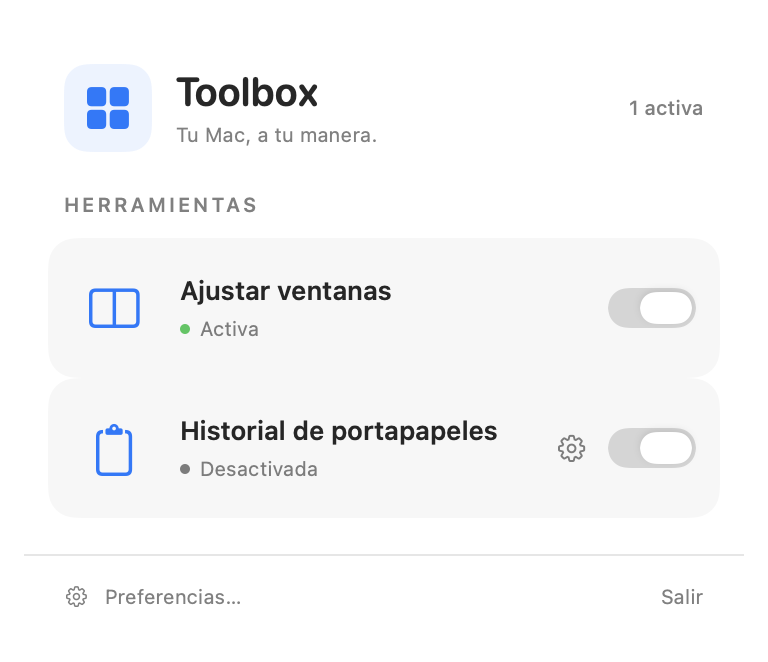

# Toolbox for macOS

[Leer en español](README.es.md)

Toolbox is a native menu bar app that puts two everyday tools one click away: window snapping and a searchable clipboard history. It's a [Gatsbysland side project](https://gatsbysland.com/en#quests) built with Swift, SwiftUI and AppKit.



## What you can do

- **Snap windows.** Drag a window to the left or right edge to fill half the screen, or to the top to fill the available desktop. Release when you see the preview. You can set the gap between windows and restore their previous size when you drag them away.
- **Find something you copied.** Press **⇧⌘V** (or record your own shortcut) to search text, rich text, links, images, PDFs and file references from Finder. Select an entry and press Return or click it to put it back on the clipboard. Paste normally with **⌘V**. Toolbox can play a short sound when it captures or copies an entry.
- **Paste back into the previous app.** Enable **Pegar al seleccionar** in the clipboard settings if you want selecting an entry to paste it where you were working. This is off by default. You can always choose **Volver a copiar** in the entry's context menu to copy it without pasting.

Open the four-square icon in the menu bar to switch tools on or off and open preferences. The app interface is currently in Spanish.

## Build and run

You'll need an **Apple Silicon Mac running macOS 26 or later** and **Xcode 26 or later** with Swift 6.2 and the macOS 26 SDK. Toolbox is available as source code. The first public release has no ready-to-install app.

Clone the repo and choose a valid **Apple Development** signing identity with its private key in your local Keychain. You can manage your development certificates under **Xcode → Settings → Accounts → Manage Certificates**.

```sh
git clone https://github.com/gatsbys/macos-toolbox.git
cd macos-toolbox
security find-identity -v -p codesigning
./Scripts/setup-signing.sh YOUR_CERTIFICATE_SHA1
./Scripts/dev.sh
```

Run the signing setup once. The selected fingerprint is stored in the ignored `Config/LocalSigning.xcconfig`. Keep the same identity across builds so macOS can recognise the app when it checks Accessibility permission.

Use `./Scripts/dev.sh` whenever you build and launch Toolbox. It verifies the signature, closes existing copies, and installs and opens `~/Applications/Toolbox Dev.app` with the identifier `com.cristian.Toolbox.debug`. Use Xcode to edit the project and this script to launch it from its stable path.

## Permissions and privacy

| macOS permission | When Toolbox uses it |
| --- | --- |
| **Accessibility** | To move and resize windows and to send **⌘V** when optional automatic paste is enabled. Use **Preferencias → General → Dar permiso…** and enable **Toolbox Dev** in System Settings. |
| **Paste from Other Apps** | If macOS restricts clipboard reads, allow Toolbox under **Privacy & Security → Paste from Other Apps** for automatic capture. Use **Permitir acceso…** in the clipboard settings. Clipboard capture and copying from history do not require Accessibility. |

If Toolbox and macOS both try to snap a window, turn off macOS drag-to-tile options under **Desktop & Dock → Windows**. If dragging to the top opens Mission Control, turn off that gesture there as well.

Clipboard history stays on this Mac. There are no accounts, servers, telemetry or remote link previews. History is stored with user-only permissions under `~/Library/Application Support/<bundle-id>/ClipboardHistory`, with separate data for the dev and release builds. Finder files are kept as references to their original locations. Toolbox skips copies with common sensitive or temporary clipboard markers and captures made while 1Password is active. Other apps may put sensitive data on the clipboard without those markers.

Delete an entry from its context menu, or use **Preferencias → Historial de portapapeles → Vaciar historial…** to delete saved entries. Clearing history leaves the current macOS clipboard intact. Turn off the clipboard tool to stop capturing new copies.

## Develop and test

The menu and preferences are in `Toolbox/Interface`. `Toolbox/WindowSnapping` handles window movement and previews, while `Toolbox/Clipboard` handles capture, storage and paste. To add a tool, implement `ToolModule` and register it in `AppModel`. See [AGENTS.md](AGENTS.md) for the local build rules.

```sh
./Scripts/test.sh              # Swift tests, no signing identity needed
./Scripts/dev.sh --build-only  # build and verify the app without launching
./Scripts/test-signing.sh      # verify signing continuity between builds
```

## Contribute and support

[Open an issue](https://github.com/gatsbys/macos-toolbox/issues) for bugs or ideas. Include the Toolbox and macOS versions and use invented clipboard data in examples. For vulnerabilities, follow the [private reporting instructions](SECURITY.md). Run `./Scripts/test.sh` before opening a pull request.

> You may fork and modify this repository solely to propose those changes back to this project as a pull request. By opening a pull request, you agree that your contribution becomes part of the project under its license and grant the copyright holder a perpetual, worldwide, irrevocable, royalty-free right to use, modify, distribute and relicense it.

If Toolbox makes your day a little easier, you can [buy me a coffee](https://www.buymeacoffee.com/the.gatsbys).

## License

Toolbox is source-available for noncommercial use under the [PolyForm Strict License 1.0.0](LICENSE). The license does not grant permission to redistribute or modify the software. The pull request exception above grants permission only for that purpose.

Copyright © 2026 Cristian de Murcia.
